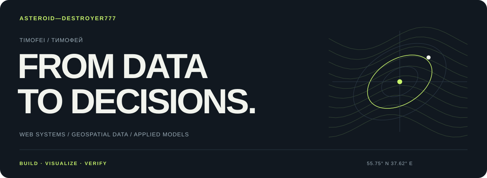
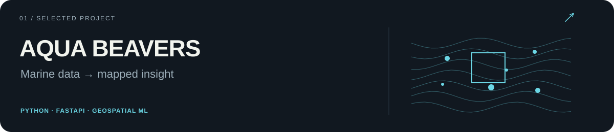
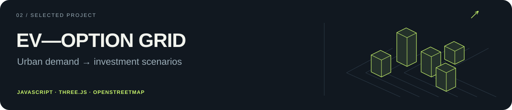
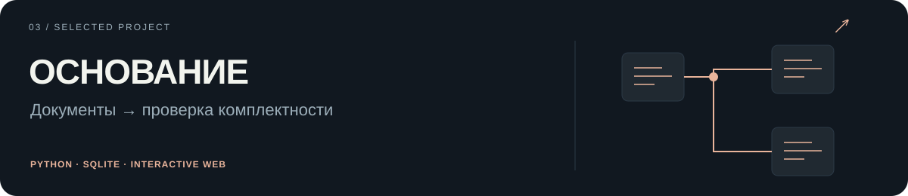
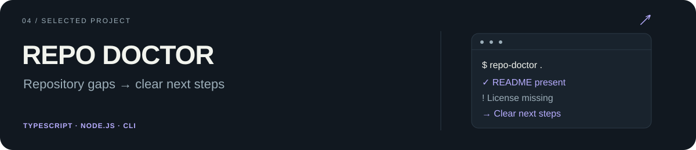

  

  <a href="https://github.com/Asteroid-Destroyer777?tab=repositories"><b>Все проекты ↗</b></a>
  &nbsp; · &nbsp;
  <a href="https://ev-option-grid.vercel.app"><b>EV Grid — демо ↗</b></a>
  &nbsp; · &nbsp;
  <a href="https://aqua-beavers-production.up.railway.app"><b>AQUA — демо ↗</b></a>

### Привет, я Тимофей.

Разрабатываю веб-приложения, в которых данные становятся понятным инструментом: картой, моделью, проверкой или сценарием решения. В моих проектах встречаются геоаналитика, 3D-визуализация, Python и интерактивные интерфейсы.

Работаю над командными проектами **Super_Бобры**. Мне интересен весь путь: понять задачу, собрать модель, сделать удобный продукт и проверить, что результат воспроизводится.

### Избранные проекты

**Морская геоаналитика.** Командный проект КосмоХакатона-2026: детектирование скоплений макропластика, оценка концентрации, прогноз дрейфа и работа с результатами на 2D/3D-карте. Научное ядро сопровождается аудитом данных и проверкой моделей.

[Исходный код →](https://github.com/Asteroid-Destroyer777/aqua-beavers) · [Открыть сервис →](https://aqua-beavers-production.up.railway.app) · [Техническое решение →](https://github.com/Asteroid-Destroyer777/aqua-beavers/blob/main/TECHNICAL_SOLUTION.md)

**Город, энергия и инвестиции.** Интерактивный 3D-прототип для планирования зарядной сети: транспортный спрос, ограничения мощности, инвестиционные варианты и экономика в одном сценарии. Реальные объекты OpenStreetMap и явно обозначенные модельные допущения.

[Исходный код →](https://github.com/Asteroid-Destroyer777/EV-OPTION_GRID) · [Открыть демо →](https://ev-option-grid.vercel.app)

**Сложный процесс — в понятный интерфейс.** Командный прототип рабочего места сотрудника банка: связи операций и документов, замечания с переходом к источнику, история версий и отчёт. Демонстрация работает на синтетических данных.

[Исходный код →](https://github.com/Asteroid-Destroyer777/osnovanie-super-bobry) · [Открыть демо →](https://osnovanie-super-bobry.bu-rchfieldadams12.chatgpt.site)

**Инструменты для разработчика.** Небольшая CLI-утилита для офлайн-проверки репозитория: README, лицензия, руководство для участников, CI и команда тестирования.

[Исходный код →](https://github.com/Asteroid-Destroyer777/repo-doctor)

### Стек, который использую в проектах

**Разработка** · Python · JavaScript · TypeScript · Node.js · FastAPI · HTML / CSS · SQLite

**Данные и модели** · NumPy · pandas · SciPy · scikit-learn · статистический анализ · геопространственные данные

**Визуализация и инструменты** · Three.js · OpenStreetMap · Matplotlib · Git · Docker · pytest

### Ещё немного аналитики

[**Invalid Respondent Detection**](https://github.com/Asteroid-Destroyer777/git_semi_control) — поиск аномальных респондентов: устойчивые базовые оценки, Empirical Bayes, адаптивные пороги MAD и проверка по времени.

### Как я подхожу к работе

- Соединяю расчёты с интерфейсом: результат должен быть понятен человеку, который принимает решение.
- Показываю происхождение данных, допущения и ограничения модели.
- Проверяю граничные случаи и воспроизводимость, а не только красивый демонстрационный сценарий.

---

  <b>Данные → модель → интерфейс → решение.</b> 
  Для обсуждения публичных проектов — Issues в соответствующем репозитории.

